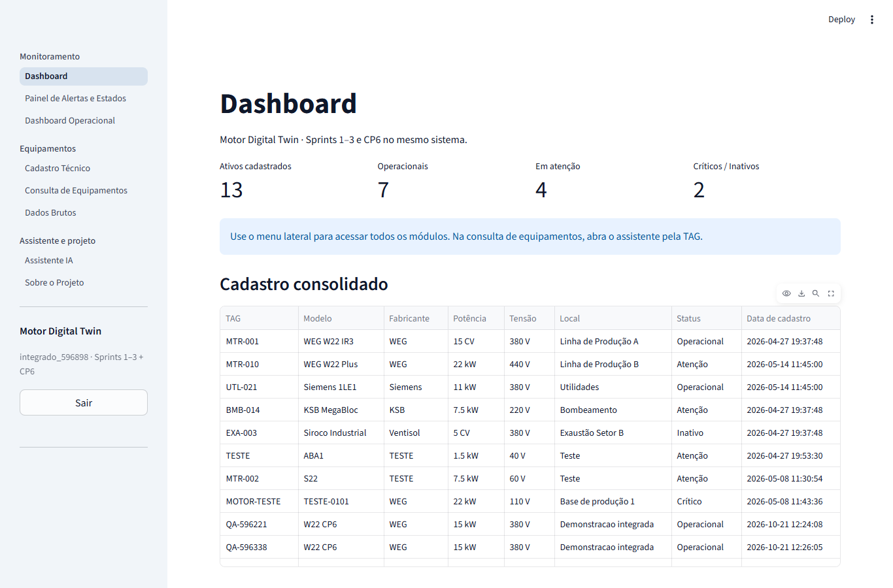

# Motor Digital Twin — Sistema integrado | Sprints 1–3 + CP6

**Front-end em Sistemas de IA · FIAP · 2TIAPY · Entrega: 25/10/2026**

Todas as entregas da disciplina no **mesmo sistema Streamlit**, com login e navegação únicos: dashboard, cadastro, consulta, ficha técnica, placa simulada, dados brutos, telemetria, gráficos, alertas, eventos e assistente com múltiplas conversas. O front consome exclusivamente a **API FastAPI via requests**. O CP6 acrescenta autenticação Bearer, autorização e histórico por usuário em **SQLite**, integrado aos equipamentos das sprints.

## Módulos no mesmo menu

| Módulo | Entrega e funcionalidades |
|---|---|
| Dashboard | Visão geral, indicadores e cadastro consolidado |
| Cadastro Técnico | Sprint 1: validação, confirmação humana, TAG única e limpeza confirmada do formulário |
| Consulta de Equipamentos | Sprint 1: ficha, observações e botão para conversar sobre a TAG |
| Dados Brutos | Sprint 1: simulação ADC e fórmulas de conversão |
| Dashboard Operacional | Sprint 2: área/planta, TAG, placa simulada, leitura e três gráficos históricos |
| Painel de Alertas e Estados | Sprint 3: thresholds originais, DEMO, estados, apoio à decisão e eventos filtráveis |
| Assistente IA | CP6: várias conversas privadas e consulta ao estado do equipamento pela TAG |
| Sobre o Projeto | Evolução das entregas e limites da demonstração |

## Integrantes

| Nome | RM |
|---|---|
| Arthur Pedreca de Almeida Vasco | 565215 |
| Bruno Lanchariche Fitipaldi Lopes | 564129 |
| Gustavo Civita Gonçalves | 561932 |
| Rafael de Paiva Ramos | 563978 |
| Thiago Santana Danyluk | 562286 |

## Vídeo de apoio

[Assistir ou baixar a demonstração do sistema completo](docs/video-cp6.mp4). Gravação local com legendas, sem narração: login, dashboard, alertas, gráficos, cadastro de equipamento, ficha técnica, chat pela TAG, dados brutos e isolamento entre contas. O [roteiro de avaliação](docs/ROTEIRO_CP6.md) permite repetir a demonstração.




## Executar o sistema do zero

Pré-requisitos: **Python 3.11 ou 3.12** e Git. Validado com Python 3.12.14. Sem chave de IA ou serviço externo. Os comandos abaixo são para **PowerShell no Windows**, sem ativação de ambientes virtuais.

```powershell
git clone https://github.com/Danylukk/SPRINT-FrontEND.git
cd SPRINT-FrontEND
```

### Terminal 1 — backend (porta 8000)

```powershell
cd backend
python -m venv .venv
.\.venv\Scripts\python.exe -m pip install -r requirements.txt
Copy-Item .env.example .env
.\.venv\Scripts\python.exe -m uvicorn app.main:app --host 127.0.0.1 --port 8000
```

Abra [saúde da API](http://127.0.0.1:8000/health) e [documentação interativa](http://127.0.0.1:8000/docs). O banco `backend/data/chat.sqlite3` é criado automaticamente. Para reiniciar, use `Ctrl+C` e execute o último comando novamente. **Preserve esse arquivo** para manter contas, sessões e conversas.

### Terminal 2 — frontend (porta 8501)

Abra outro terminal **na raiz do repositório**:

```powershell
cd frontend
python -m venv .venv
.\.venv\Scripts\python.exe -m pip install -r requirements.txt
Copy-Item .env.example .env
.\.venv\Scripts\python.exe -m streamlit run app.py --server.address 127.0.0.1 --server.port 8501
```

Abra [o sistema](http://127.0.0.1:8501). Em **Criar conta**, cadastre usuário (3–40 caracteres: letras, números, ponto, `_` ou `-`) e senha (8–128 caracteres). Use **Entrar**: o dashboard e todos os módulos aparecem no menu lateral. Em **Assistente IA**, use **Nova conversa**; na **Consulta de Equipamentos**, use **Conversar sobre a TAG** para abrir o chat com o estado do ativo. Não há conta ou senha pré-configurada. Crie outra conta para verificar o isolamento.

O comando histórico `streamlit run app.py` na raiz agora abre **essa mesma interface integrada**. O `requirements.txt` da raiz referencia as dependências do frontend; a API continua no seu próprio processo e ambiente, conforme o CP6.

No Linux/macOS, substitua `.\.venv\Scripts\python.exe` por `.venv/bin/python` e `Copy-Item .env.example .env` por `cp .env.example .env`; os demais argumentos são iguais. Ao repetir a instalação, mantenha os `.env` existentes em vez de copiá-los novamente.

### Configuração

Cada projeto carrega seu próprio `.env`, localizado a partir do código. Variáveis do processo têm prioridade.

| Projeto | Variável | Padrão / comportamento |
|---|---|---|
| Backend | `DATABASE_PATH` | `data/chat.sqlite3`, relativo a `backend`; aceita caminho absoluto |
| Backend | `TOKEN_TTL_SECONDS` | `28800` (8 horas); positivo |
| Backend | `LLM_PROVIDER` | `simulated`; aceita também `echo` e `unavailable` |
| Backend | `MOTOR_DATA_DIR` | Opcional: caminho absoluto dos dados operacionais; padrão `data/` na raiz do repositório |
| Frontend | `API_URL` | `http://127.0.0.1:8000` |
| Frontend | `API_TIMEOUT_SECONDS` | `15`, maior que zero e até 120 |

`.env`, ambientes, bancos e dados runtime são ignorados pelo Git. Nenhuma senha ou chave de acesso é versionada.

## Arquitetura e pacotes

```text
frontend/                              backend/
  app.py → st.navigation                 app/main.py → FastAPI + lifespan
  ui_pages/ → login, motor, chat          app/routers/ → auth, motor, conversas
  components/ → ficha, gráficos, chat     app/schemas/ → Pydantic
  services/api_client.py ── requests ──→  app/services/ → regras e autorização
                                         app/repositories/ → SQLite
                                         app/llm/provider.py → bot simulado
                                         src/services/ → regras das sprints
                                         data/ → seed + runtime operacional
  requirements.txt                       requirements.txt
  .env.example                           .env.example
```

- **Backend:** FastAPI, Pydantic, Uvicorn, pandas e python-dotenv. Reaproveita os serviços de domínio em `src/` das sprints anteriores. SQLite, PBKDF2 e tokens usam a biblioteca padrão.
- **Frontend:** Streamlit, requests, pandas, Plotly e python-dotenv. Reaproveita os componentes visuais das sprints em `frontend/components/`. Não importa `src/`, backend, persistência ou modelos de linguagem.
- **Testes:** pytest e httpx. Requirements de cada projeto fixam dependências diretas; transitivas são resolvidas pelo pip.
- Dois ambientes, processos e portas independentes. Clone o repositório completo: a API usa o domínio e os dados das sprints existentes na raiz.

Rotas validam contratos e delegam aos serviços. Serviços verificam a identidade, controlam conversas e reaproveitam as regras operacionais. Repositórios cuidam do SQLite e dos dados operacionais. **Mensagens, estados e leituras são consultados por HTTP**, sem cache de histórico ou inferência no front. A sessão mantém token, identidade e ID da conversa ativa, além do estado transitório de formulários, filtros e navegação do Streamlit.

### Autenticação e autorização

Senhas são protegidas com **PBKDF2-HMAC-SHA256, salt aleatório e 600.000 iterações**, comparadas com `hmac.compare_digest`. O token opaco tem 32 bytes aleatórios; somente seu SHA-256 é salvo no banco com validade. Logout revoga a sessão no servidor.

A identidade vem de `Authorization: Bearer <token>`. O cliente não escolhe o ID do usuário. **Todos os endpoints de equipamentos e conversas são protegidos.** O cadastro operacional é compartilhado pelas contas do projeto; cada conversa pertence somente ao seu dono. Acesso à conversa de outro usuário retorna 404. Cadastro de conta público é para demonstração acadêmica local; recuperação de senha, limites de tentativas e infraestrutura de uso público não integram esta entrega.

### Modelo escolhido

**`simulated` / `motor-assistant-rules-v1`**: bot por regras, permitido pelo enunciado, sem custo ou limite externo. Ao mencionar uma TAG cadastrada (ex.: “Como está o MTR-001?”), o backend consulta o mesmo estado analítico do painel e responde com status, resumo, data, origem e ID da leitura; sinaliza dados desatualizados. A ficha possui um botão que cria a conversa e faz essa consulta. Respostas antigas representam a leitura daquela interação; pergunte novamente com a TAG após atualizar a DEMO. Perguntas genéricas continuam demonstrando API, autenticação e persistência. Não é LLM, não usa Gemini, RAG, embeddings ou sensores reais; recomendações são as regras acadêmicas da Sprint 3.

Altere `LLM_PROVIDER=echo` no `.env` do backend e reinicie para trocar o comportamento sem alterar rotas/front. Para testar 503, use `LLM_PROVIDER=unavailable`: health informa `degraded`, e o envio falha antes de gravar mensagens. Restaure `simulated` ao terminar.

## Endpoints do CP6

| Método e rota | Acesso | Resultado |
|---|---|---|
| `GET /health` | Público | 200, saúde, provider e modelo |
| `POST /auth/register` | Público | 201, conta; 409, nome em uso |
| `POST /auth/login` | Público | 200, token e identidade; 401, credenciais inválidas |
| `GET /auth/me` | Bearer | 200, identidade do token |
| `POST /auth/logout` | Bearer | 204, token revogado |
| `GET /conversas` | Bearer | 200, somente suas conversas |
| `POST /conversas` | Bearer | 201, nova conversa; corpo `{}` ou `{"titulo":"..."}` |
| `GET /conversas/{id}` | Bearer | 200, histórico; 404, ausente ou de outra conta |
| `POST /conversas/{id}/mensagens` | Bearer | 201, mensagem e resposta; 503, provider/armazenamento indisponível |
| `GET /motor/equipamentos` | Bearer | Cadastro consolidado das entregas |
| `POST /motor/equipamentos` | Bearer | 201, cadastro com `confirmar=true`; 409, TAG duplicada |
| `GET /motor/painel` | Bearer | Estados, alertas e eventos; `include_seed=true` inclui referências |
| `GET /motor/equipamentos/{tag}` | Bearer | Ficha, snapshot e histórico da TAG |
| `POST /motor/equipamentos/{tag}/demo` | Bearer | Alternância da DEMO e registro de transição |
| `POST /motor/equipamentos/{tag}/leituras` | Bearer | Nova leitura simulada |
| `GET /motor/equipamentos/{tag}/sensores` | Bearer | Dados ADC e conversões da Sprint 1 |

Cadastro/login: `{"usuario":"seu_usuario","senha":"sua_senha"}`. Mensagem: `{"conteudo":"O que é uma API?"}`. `/docs` documenta entrada, saída, descrições e **Authorize**. Rotas protegidas retornam **401** para token ausente, inválido, expirado ou revogado; entradas inválidas retornam **422**. Mensagens aceitam 1–4.000 caracteres após remover espaços das extremidades. O título automático vem da primeira mensagem (até 60 caracteres).

## Erros e persistência

O cliente HTTP centraliza timeout, Bearer e mensagens amigáveis para API desligada, timeout, 401, 404, 409, 422 e 503, sem traceback na UI. Erros não viram histórico vazio. Uma sessão inválida limpa a identidade local e solicita novo login.

Não há retry automático de POST: após falha de comunicação, clique em **Atualizar histórico** antes de reenviar, pois uma gravação pode ter ocorrido. Mensagem e resposta são gravadas na **mesma transação**; falha no segundo INSERT desfaz o primeiro. SQLite mantém dados após reinício com o mesmo `DATABASE_PATH`. Recarregar completamente o navegador pode exigir novo login, mas as conversas continuam na API.

### Dados das sprints

`data/equipments.json`, `data/telemetry_history.csv` e `data/event_history.csv` são referências versionadas. A API lê essas bases e grava **novos cadastros, leituras e eventos somente em `data/runtime/`**, ignorado pelo Git. Cadastros novos se somam aos antigos, sem sobrescrever o seed. Mantenha esse diretório ao reiniciar para preservar a evolução operacional. Arquivos inválidos são preservados e resultam em 503, sem lista vazia de fallback.

Os thresholds, fórmulas, regras DEMO e `mock_nlp` originais foram reutilizados. Leituras e inferências são mantidas no backend, com IDs consistentes entre painel, ficha e chat. Reruns de leitura não geram eventos novos. Os dados operacionais são JSON/CSV locais; esta demonstração usa **um único processo Uvicorn**, com serialização das alterações operacionais. Escala em vários workers não faz parte desta entrega.

## Testar o CP6 e as regressões

Na raiz, em um ambiente separado:

```powershell
python -m venv .venv-tests
.\.venv-tests\Scripts\python.exe -m pip install -r requirements.txt -r requirements-dev.txt
.\.venv-tests\Scripts\python.exe -m pytest -q
.\.venv-tests\Scripts\python.exe -m compileall -q backend frontend src tests
.\.venv-tests\Scripts\python.exe -m pip check
git diff --check
```

Cobertura: contratos HTTP, isolamento, token expirado/revogado, validação, múltiplas conversas, persistência, atomicidade, provider 503, cliente HTTP, regressões da Sprint 3 e integração dos equipamentos com o chat. Os testes das sprints pela API usam arquivos temporários e verificam que cadastro/DEMO preservam os seeds, não duplicam eventos e sobrevivem à recriação da API.

**Validação local em 21/10/2026:** 62 testes passaram. Instalações independentes, `pip check`, compilação Python e entrada compatível da raiz verificados. No navegador: todos os módulos, cadastro fictício, consulta, gráficos, chat pela TAG, múltiplas conversas, troca entre módulos, isolamento entre contas e navegação móvel (390 × 844). A gravação usa a aplicação real e não registrou erros de console. A avaliação em outras máquinas depende de seguir os pré-requisitos e comandos acima.

## Conteúdo das aulas aplicado

Modularização, estado, autenticação, FastAPI e requests das aulas 3, 6, 7 e 11–15. Material: [FIAP de Lucas Rios](https://github.com/LucasRios/FIAP). Referências: [FastAPI — segurança](https://fastapi.tiangolo.com/tutorial/security/) e [Streamlit — chat](https://docs.streamlit.io/develop/api-reference/chat).

## Histórico das entregas

Consulte [a documentação histórica da Sprint 3](docs/SPRINT3.md). As regras originais em `src/services/`, `src/repositories/` e `src/models/` foram preservadas e são utilizadas pelo backend. As telas atuais estão integradas em `frontend/`; `app.py` da raiz é uma entrada compatível para esse mesmo sistema. Use os passos deste README para executar a versão completa.
