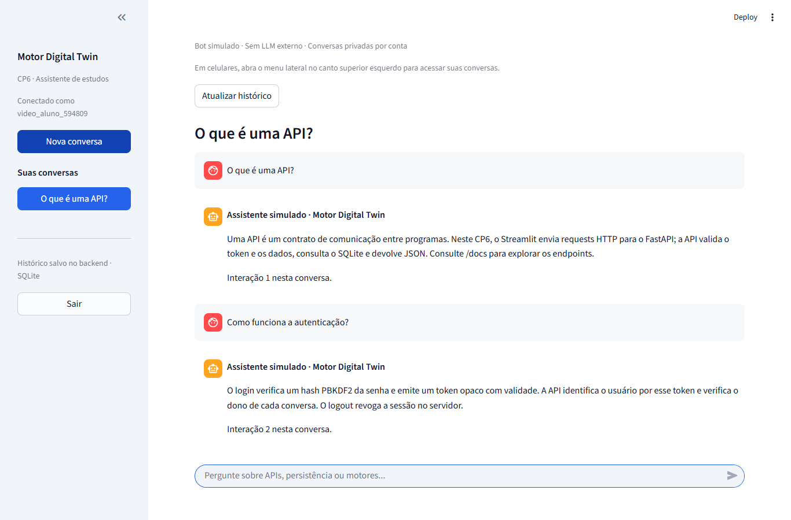

# CP6 — Chat com múltiplas conversas | Motor Digital Twin

**Front-end em Sistemas de IA · FIAP · 2TIAPY · Entrega: 25/10/2026**

Evolução do repositório da disciplina: o CP6 adiciona um chat em **Streamlit**, consumindo exclusivamente uma **API FastAPI via requests**, com contas individuais, autenticação Bearer, autorização por proprietário e múltiplas conversas persistidas em **SQLite**. As Sprints 1–3 do Motor Digital Twin continuam disponíveis na raiz, com o código original preservado.

## Integrantes

| Nome | RM |
|---|---|
| Arthur Pedreca de Almeida Vasco | 565215 |
| Bruno Lanchariche Fitipaldi Lopes | 564129 |
| Gustavo Civita Gonçalves | 561932 |
| Rafael de Paiva Ramos | 563978 |
| Thiago Santana Danyluk | 562286 |

## Vídeo de apoio

[Assistir ou baixar a demonstração do CP6](docs/video-cp6.mp4). Gravação local com legendas das etapas, sem narração: cadastro, login, mensagens, criação e retomada de conversas e isolamento entre contas. O [roteiro de avaliação](docs/ROTEIRO_CP6.md) permite repetir a demonstração.



## Executar o CP6 do zero

Pré-requisitos: **Python 3.11 ou 3.12** e Git. Validado com Python 3.12.14. Sem chave de IA ou serviço externo. Os comandos abaixo são para **PowerShell no Windows**, sem ativação de ambientes virtuais.

```powershell
git clone https://github.com/Danylukk/SPRINT-FrontEND.git
cd SPRINT-FrontEND
```

### Terminal 1 — backend (porta 8000)

```powershell
cd backend
python -m venv .venv
.\.venv\Scripts\python.exe -m pip install -r requirements.txt
Copy-Item .env.example .env
.\.venv\Scripts\python.exe -m uvicorn app.main:app --host 127.0.0.1 --port 8000
```

Abra [saúde da API](http://127.0.0.1:8000/health) e [documentação interativa](http://127.0.0.1:8000/docs). O banco `backend/data/chat.sqlite3` é criado automaticamente. Para reiniciar, use `Ctrl+C` e execute o último comando novamente. **Preserve esse arquivo** para manter contas, sessões e conversas.

### Terminal 2 — frontend (porta 8501)

Abra outro terminal **na raiz do repositório**:

```powershell
cd frontend
python -m venv .venv
.\.venv\Scripts\python.exe -m pip install -r requirements.txt
Copy-Item .env.example .env
.\.venv\Scripts\python.exe -m streamlit run app.py --server.address 127.0.0.1 --server.port 8501
```

Abra [o chat](http://127.0.0.1:8501). Em **Criar conta**, cadastre usuário (3–40 caracteres: letras, números, ponto, `_` ou `-`) e senha (8–128 caracteres). Use a aba **Entrar**, depois **Nova conversa**. Não há conta ou senha pré-configurada. Crie outra conta para verificar o isolamento.

No Linux/macOS, substitua `.\.venv\Scripts\python.exe` por `.venv/bin/python` e `Copy-Item .env.example .env` por `cp .env.example .env`; os demais argumentos são iguais. Ao repetir a instalação, mantenha os `.env` existentes em vez de copiá-los novamente.

### Configuração

Cada projeto carrega seu próprio `.env`, localizado a partir do código. Variáveis do processo têm prioridade.

| Projeto | Variável | Padrão / comportamento |
|---|---|---|
| Backend | `DATABASE_PATH` | `data/chat.sqlite3`, relativo a `backend`; aceita caminho absoluto |
| Backend | `TOKEN_TTL_SECONDS` | `28800` (8 horas); positivo |
| Backend | `LLM_PROVIDER` | `simulated`; aceita também `echo` e `unavailable` |
| Frontend | `API_URL` | `http://127.0.0.1:8000` |
| Frontend | `API_TIMEOUT_SECONDS` | `15`, maior que zero e até 120 |

`.env`, ambientes, bancos e dados runtime são ignorados pelo Git. Nenhuma senha ou chave de acesso é versionada.

## Arquitetura e pacotes do CP6

```text
frontend/                              backend/
  app.py → st.navigation                 app/main.py → FastAPI + lifespan
  ui_pages/ → login, chat                 app/routers/ → APIRouter
  components/ → lista, mensagens          app/schemas/ → Pydantic
  services/api_client.py ── requests ──→  app/services/ → regras e autorização
                                         app/repositories/ → SQLite
                                         app/llm/provider.py → bot simulado
  requirements.txt                       requirements.txt
  .env.example                           .env.example
```

- **Backend:** FastAPI, Pydantic, Uvicorn e python-dotenv. SQLite, PBKDF2 e geração de tokens usam a biblioteca padrão do Python.
- **Frontend:** Streamlit, requests e python-dotenv. Não importa o backend nem chama modelos diretamente.
- **Testes:** pytest e httpx. Requirements de cada projeto fixam dependências diretas; transitivas são resolvidas pelo pip.
- Dois ambientes, processos e portas independentes. O `requirements.txt` da raiz continua pertencendo às sprints anteriores.

Rotas validam contratos e delegam aos serviços. Serviços verificam o usuário, controlam conversas e chamam repositórios e provider. Repositórios executam SQL parametrizado e transações. O estado de aplicação no front contém somente token, identidade e ID da conversa ativa; widgets possuem seu estado transitório normal. **Histórico e lista de conversas são consultados por HTTP a cada renderização**, sem guardar mensagens na sessão.

### Autenticação e autorização

Senhas são protegidas com **PBKDF2-HMAC-SHA256, salt aleatório e 600.000 iterações**, comparadas com `hmac.compare_digest`. O token opaco tem 32 bytes aleatórios; somente seu SHA-256 é salvo no banco com validade. Logout revoga a sessão no servidor.

A identidade vem de `Authorization: Bearer <token>`. O cliente não escolhe o ID do usuário. Cada conversa é consultada pelo ID **e pelo dono autenticado**. Acesso a conversa de outro usuário retorna 404. O cadastro público é para demonstração acadêmica local; recuperação de senha, limites de tentativas e infraestrutura de uso público não integram esta entrega.

### Modelo escolhido

**`simulated` / `motor-assistant-rules-v1`**: respostas por regras sobre APIs, autenticação, persistência e motores, com contagem de interações baseada no histórico. É o bot simulado permitido pelo enunciado, sem custo ou limite externo. Não é LLM, não usa Gemini, RAG, embeddings ou sensores reais e não executa diagnósticos de manutenção.

Altere `LLM_PROVIDER=echo` no `.env` do backend e reinicie para trocar o comportamento sem alterar rotas/front. Para testar 503, use `LLM_PROVIDER=unavailable`: health informa `degraded`, e o envio falha antes de gravar mensagens. Restaure `simulated` ao terminar.

## Endpoints do CP6

| Método e rota | Acesso | Resultado |
|---|---|---|
| `GET /health` | Público | 200, saúde, provider e modelo |
| `POST /auth/register` | Público | 201, conta; 409, nome em uso |
| `POST /auth/login` | Público | 200, token e identidade; 401, credenciais inválidas |
| `GET /auth/me` | Bearer | 200, identidade do token |
| `POST /auth/logout` | Bearer | 204, token revogado |
| `GET /conversas` | Bearer | 200, somente suas conversas |
| `POST /conversas` | Bearer | 201, nova conversa; corpo `{}` ou `{"titulo":"..."}` |
| `GET /conversas/{id}` | Bearer | 200, histórico; 404, ausente ou de outra conta |
| `POST /conversas/{id}/mensagens` | Bearer | 201, mensagem e resposta; 503, provider/armazenamento indisponível |

Cadastro/login: `{"usuario":"seu_usuario","senha":"sua_senha"}`. Mensagem: `{"conteudo":"O que é uma API?"}`. `/docs` documenta entrada, saída, descrições e **Authorize**. Rotas protegidas retornam **401** para token ausente, inválido, expirado ou revogado; entradas inválidas retornam **422**. Mensagens aceitam 1–4.000 caracteres após remover espaços das extremidades. O título automático vem da primeira mensagem (até 60 caracteres).

## Erros e persistência

O cliente HTTP centraliza timeout, Bearer e mensagens amigáveis para API desligada, timeout, 401, 404, 409, 422 e 503, sem traceback na UI. Erros não viram histórico vazio. Uma sessão inválida limpa a identidade local e solicita novo login.

Não há retry automático de POST: após falha de comunicação, clique em **Atualizar histórico** antes de reenviar, pois uma gravação pode ter ocorrido. Mensagem e resposta são gravadas na **mesma transação**; falha no segundo INSERT desfaz o primeiro. SQLite mantém dados após reinício com o mesmo `DATABASE_PATH`. Recarregar completamente o navegador pode exigir novo login, mas as conversas continuam na API.

## Testar o CP6 e as regressões

Na raiz, em um ambiente separado:

```powershell
python -m venv .venv-tests
.\.venv-tests\Scripts\python.exe -m pip install -r requirements.txt -r requirements-dev.txt
.\.venv-tests\Scripts\python.exe -m pytest -q
.\.venv-tests\Scripts\python.exe -m compileall -q backend frontend src tests
.\.venv-tests\Scripts\python.exe -m pip check
git diff --check
```

Cobertura: contratos HTTP, isolamento, token expirado/revogado, validação, múltiplas conversas, persistência ao recriar a aplicação, atomicidade em falha de escrita, provider 503, cliente HTTP e regressões da Sprint 3. Testes usam bancos temporários, sem serviços externos. O roteiro inclui reinício do processo real e verificação no navegador.

**Validação local em 21/10/2026:** 48 testes passaram. Também foram verificados instalação em ambientes independentes, `pip check`, compilação Python, interface desktop (1366 × 900), interface móvel (390 × 844), isolamento visual entre contas, retomada após reinício real da API e mensagem amigável com a API desligada. O vídeo foi gravado usando a aplicação real, sem erros de console. A avaliação em outras máquinas depende de seguir os pré-requisitos e comandos acima.

## Conteúdo das aulas aplicado

Modularização, estado, autenticação, FastAPI e requests das aulas 3, 6, 7 e 11–15. Material: [FIAP de Lucas Rios](https://github.com/LucasRios/FIAP). Referências: [FastAPI — segurança](https://fastapi.tiangolo.com/tutorial/security/) e [Streamlit — chat](https://docs.streamlit.io/develop/api-reference/chat).

## Sprints anteriores — execução independente

O `app.py`, `src/` e dados originais continuam na raiz. Consulte [a documentação preservada da Sprint 3](docs/SPRINT3.md). Execute em ambiente com o `requirements.txt` da raiz instalado:

```powershell
python -m streamlit run app.py --server.port 8502
```

O CP6 preserva o contexto Motor Digital Twin em um chat independente. Não altera o pipeline de telemetria das sprints.
