# Documentação Final do Projeto — Sprint 4

<div align="center">

**FIAP — Faculdade de Informática e Administração Paulista**  
**Curso:** Inteligência Artificial · **Turma:** 2TIAPY · **Ano:** 2026  
**Disciplina:** FrontEnd (Front-end em Sistemas de IA)  
**Challenge:** Forzy · **Projeto:** Motor Digital Twin  
**Entrega:** Sprint 4 — Documentação Final do Projeto  

</div>

---

## Identificação do Grupo

| Integrante | RM |
|---|---|
| Arthur Pedreca de Almeida Vasco | 565215 |
| Bruno Lanchariche Fitipaldi Lopes | 564129 |
| Gustavo Civita Gonçalves | 561932 |
| Rafael de Paiva Ramos | 563978 |
| Thiago Santana Danyluk | 562286 |

---

## Sumário

- [1. Introdução](#1-introdução)
- [2. Evolução desde a Sprint 3](#2-evolução-desde-a-sprint-3)
  - [2.1. Entrega oficial da Sprint 3 (`3da6303`)](#21-entrega-oficial-da-sprint-3-3da6303)
  - [2.2. Evolução até a apresentação final do Challenge e CP6 posterior](#22-evolução-até-a-apresentação-final-do-challenge-e-cp6-posterior)
  - [2.3. Comparativo antes e depois](#23-comparativo-antes-e-depois)
  - [2.4. Rastreabilidade](#24-rastreabilidade)
- [3. Diferenciais e resultados da solução](#3-diferenciais-e-resultados-da-solução)
  - [3.1. Experiência do usuário (UX)](#31-experiência-do-usuário-ux)
  - [3.2. Diferenciais técnicos de FrontEnd e integração](#32-diferenciais-técnicos-de-frontend-e-integração)
  - [3.3. Jornada do usuário](#33-jornada-do-usuário)
  - [3.4. Resultados alcançados](#34-resultados-alcançados)
  - [3.5. Atendimento ao Challenge Forzy](#35-atendimento-ao-challenge-forzy)
- [4. Pendências, justificativas e melhorias futuras](#4-pendências-justificativas-e-melhorias-futuras)
- [5. Ir além — arquitetura orientada à produção](#5-ir-além--arquitetura-orientada-à-produção)
- [6. Conclusão](#6-conclusão)
- [Referências e evidências](#referências-e-evidências)

---

## 1. Introdução

No contexto do **Challenge Forzy**, equipes de manutenção industrial enfrentam a dispersão de dados técnicos e operacionais de motores elétricos: especificações de placa, histórico de medições, eventos de desvio e orientações de inspeção ficam isolados em registros distintos, dificultando a leitura rápida da condição do ativo antes da atuação em campo.

Para endereçar esse problema na disciplina de **FrontEnd**, o grupo construiu de forma incremental a aplicação **Motor Digital Twin** no repositório oficial [`Danylukk/SPRINT-FrontEND`](https://github.com/Danylukk/SPRINT-FrontEND):

- **Sprint 1 (`2388f06`, 08/05/2026):** cadastro técnico com confirmação humana, consulta por TAG, ficha técnica, simulação de leitura bruta ADC com conversão para unidades de engenharia e persistência local em JSON.
- **Sprint 2 (`4277509`, 14/05/2026):** `Dashboard Operacional` por área/planta e TAG, telemetria simulada em CSV, avaliação por limites determinísticos (`AlertService`), placa visual simulada em HTML e três séries temporais em Plotly.
- **Sprint 3 (`3da6303`, 31/08/2026):** painel inicial **Painel de Alertas e Estados** antes da seleção individual do ativo, contrato analítico desacoplado (`OperationalSnapshot` e `AnalyticsProvider`), demonstração determinística (`MTR-001`), registro de transições reais sem duplicação e resumos determinísticos por templates (`mock_nlp`).
- **CP6 (`b4894fe`, 21/10/2026):** evolução posterior da disciplina que separou a interface Streamlit (`frontend/`) de uma API REST FastAPI (`backend/`) consumida via HTTP (`requests`), acrescentando autenticação Bearer, histórico privado por conta em SQLite e **Assistente IA** por regras integrado à consulta dos equipamentos pela TAG.

Esta **Sprint 4** consolida documentalmente o projeto sem novos desenvolvimentos, refatorações ou alterações em regras de negócio. Toda afirmação técnica fundamenta-se exclusivamente na auditoria do código-fonte, do histórico Git, na reexecução dos testes automatizados e em capturas reais da interface obtidas em ambiente isolado em 24/11/2026.

---

## 2. Evolução desde a Sprint 3

### 2.1. Entrega oficial da Sprint 3 (`3da6303`)

A entrega oficial da Sprint 3, consolidada no commit [`3da6303`](https://github.com/Danylukk/SPRINT-FrontEND/commit/3da6303304bc29accc307d6356c8b9733da256d1) (31/08/2026) e apresentada no [vídeo oficial da entrega](https://youtu.be/_mkTfZE0Fd8), operava como aplicação **monolítica em processo único Python/Streamlit** (`app.py` executando `src/ui/sprint3_pages.py`). Suas dependências (`requirements.txt`) resumiam-se a `streamlit>=1.35.0`, `pandas>=2.2.0` e `plotly>=5`, com persistência local em JSON e CSV.

> **Verificação de fontes primárias (ZIP da Sprint 3):** A busca realizada nos diretórios da disciplina em 24/11/2026 identificou apenas pacotes `.zip` de outras disciplinas (Visão Computacional, Cluster Computing, Computação Quântica, Governança e PLN), não havendo arquivo `.zip` original da Sprint 3 de FrontEnd disponível localmente. Assim, o commit `3da6303` e o vídeo da entrega constituem as fontes primárias auditadas.

**Figura 1 — Arquitetura Monolítica da Sprint 3** · **Versão:** Sprint 3 (`3da6303`) · **Origem:** Diagrama técnico elaborado a partir da inspeção de `app.py` e `src/`  
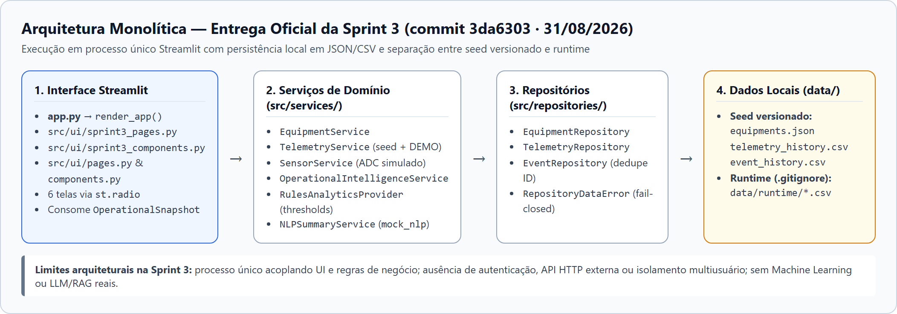  
*Comprova o acoplamento em processo único entre interface Streamlit, serviços de domínio (`src/services/`), repositórios (`src/repositories/`) e arquivos locais (`data/` e `data/runtime/`).*

Na camada analítica, a Sprint 3 manteve transparência explícita sobre o caráter simulado e determinístico dos dados:

- **`RulesAnalyticsProvider`** (`src/services/analytics_provider.py`): implementa o protocolo `AnalyticsProvider` usando os limites fixos de `AlertService` (`<= 70 / <= 85 °C`, `<= 4,5 / <= 7,0 mm/s` e `<= 100% / <= 115%` da corrente nominal), com `score=None` (sem Machine Learning).
- **`NLPSummaryService`** (`src/services/nlp_summary_service.py`): gera resumos e recomendações por templates determinísticos (`if/elif`) e declara `provider = "mock_nlp"` (sem LLM ou RAG).
- **`OperationalSnapshot`** (`src/services/operational_intelligence_service.py`): DTO imutável consumido pelo painel de alertas com estado analítico, severidade, métrica dominante, resumo, recomendação, `source`, `reading_id`, `inference_id` e `is_stale` (> 120 minutos).

#### Tabela 1 — Inventário da auditoria da Sprint 3 (`3da6303`)

| Funcionalidade | Estado na Sprint 3 | Arquivo responsável | Evidência | Limitação |
|---|---|---|---|---|
| Cadastro técnico de equipamentos | Implementado | `equipment_service.py`, `pages.py` | Validação de campos obrigatórios, valores > 0, TAG única em maiúsculas, confirmação humana (`confirm_save`) e limpeza versionada. | Escrita direta em `data/equipments.json`, sem controle de concorrência ou autenticação. |
| Consulta por TAG | Implementado | `equipment_service.py`, `pages.py` | Tabela geral em `Consulta de Equipamentos` e `st.selectbox` por TAG via `get_by_tag()`. | Consulta isolada, sem integração com histórico conversacional ou API HTTP. |
| Ficha técnica | Implementado | `pages.py`, `components.py` | `render_technical_sheet()` exibe card resumo, 3 blocos HTML (`Identificação`, `Especificações`, `Instalação e condição`) e observações. | Depende de HTML inline sem definição explícita de tema em `.streamlit/config.toml`. |
| Dashboard operacional | Implementado | `pages.py` | Filtra por área/planta e TAG, gera leitura simulada e exibe saúde geral, cards, gráficos e placa. | Consome `AlertService` direto (não `OperationalSnapshot`), com fallback visual divergente para `"Indisponível"`. |
| Séries temporais | Implementado | `telemetry_service.py`, `pages.py` | `prepare_chart_data()` limita a 48 pontos por TAG; `render_telemetry_charts()` gera 3 gráficos `px.line`. | `template="plotly_dark"` e `plot_bgcolor` translúcido geravam fundo acinzentado no tema claro padrão. |
| Telemetria simulada | Implementado | `telemetry_service.py` | `generate_reading()` simula séries determinísticas; `generate_demo_reading()` alterna baseline (3,2 mm/s) e crítico (7,8 mm/s). | Sem leitura contínua ou sensores reais; atualização exclusivamente manual. |
| Painel de alertas e estados | Implementado | `sprint3_pages.py`, `sprint3_components.py` | Tela inicial (`MENU_OPTIONS[0]`) com KPIs, até 4 cards prioritários, tabela ordenada, apoio à decisão e eventos. | No tema claro padrão, cards escuros sem `color` explícito no container exibiam títulos internos escuros com baixo contraste. |
| Classificação de estados | Implementado | `alert_service.py`, `analytics_provider.py` | Estados `Saudável`, `Atenção`, `Crítico` e `Indisponível` (`NaN`/inválido nunca promovido a crítico). | Regras estáticas por limiar fixo; `HEALTH_STYLES` de `components.py` não cobria `"Indisponível"`. |
| Histórico de transições | Implementado | `operational_event.py`, `event_repository.py` | Grava `OperationalEvent` apenas quando `previous_status != snapshot.status`, com filtros por TAG, severidade e limite (10/30/50). | Armazenamento linear em CSV; deduplicação restrita ao arquivo runtime por `(reading_id, inference_id)`. |
| Recomendações por regras | Implementado | `nlp_summary_service.py` | `build_recommendation()` sugere ação inicial conforme estado e métrica dominante. | Sem parametrização por modelo de ativo nem registro de validação humana. |
| Resumos por templates | Implementado | `nlp_summary_service.py` | `build_summary()` monta texto determinístico e exibe `mock_nlp` no rodapé do card. | Templates fixos; sem geração linguística adaptativa nem consulta a manuais (RAG). |
| Dados brutos simulados | Implementado | `sensor_service.py`, `pages.py` | Simula ADC (`temperatura_raw`, `corrente_raw`, `rotacao_raw`) e converte com divisor `1023`. | Valores gerados por `randint()`, sem conexão ESP32/MQTT. |
| Placa simulada do motor | Implementado | `components.py` | `render_simulated_nameplate()` renderiza placa metálica HTML/CSS com selo `SIMULADA \| OCR FUTURO`. | Apenas visual estático; não executa OCR real em fotografias. |
| Estado administrativo vs. analítico | Implementado | `equipment.py`, `operational_intelligence_service.py` | `status_operacional` (ex.: `Inativo`) não determina `OperationalSnapshot.status`. | Exige que o operador distinga cadastro administrativo de condição da telemetria. |
| IDs de leitura e inferência | Implementado | `telemetry_service.py`, `operational_intelligence_service.py` | Cada leitura recebe `reading_id` e cada análise recebe `inference_id`, exibidos na UI e nos eventos. | Ausência de `trace_id` distribuído ou logs estruturados. |
| Separação seed vs. runtime | Implementado | `telemetry_repository.py`, `event_repository.py`, `.gitignore` | `telemetry_history.csv` (385 linhas) e `event_history.csv` (3 eventos) preservados; novas gravações vão para `data/runtime/`. | Não aplicada ao `EquipmentRepository` na Sprint 3 (`equipments.json` recebia escrita direta). |
| Dados inválidos e desatualizados | Implementado | `errors.py`, `src/repositories/*`, `operational_intelligence_service.py` | Leituras > 120 min recebem indicador neutro `"Dados desatualizados"`; JSON/CSV corrompidos disparam `RepositoryDataError` sem sobrescrita. | Seed histórico de maio/agosto de 2026 figura sempre como desatualizado até nova leitura runtime. |

**Figura 2 — Painel de Alertas e Estados após DEMO Crítico (Sprint 3)** · **Versão:** Sprint 3 (`3da6303`) · **Origem:** Captura real em `scratch/sprint3` executada em 24/11/2026 (`1440×900`)  
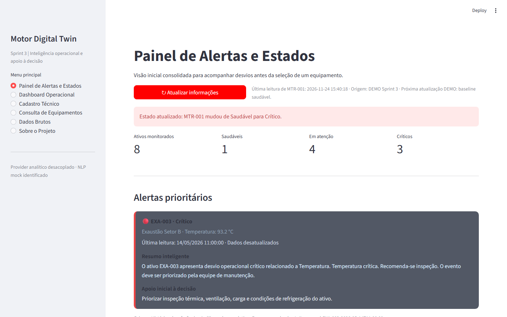  
*Comprova a transição `MTR-001` `Saudável → Crítico`, atualização dos KPIs (`8` monitorados, `1` saudável, `4` em atenção, `3` críticos) e o contraste herdado nos cabeçalhos internos do card escuro sobre o tema claro padrão do Streamlit.*

**Figura 3 — Histórico de Eventos e Apoio à Decisão (Sprint 3)** · **Versão:** Sprint 3 (`3da6303`) · **Origem:** Captura real em `scratch/sprint3` executada em 24/11/2026 (`1440×900`)  
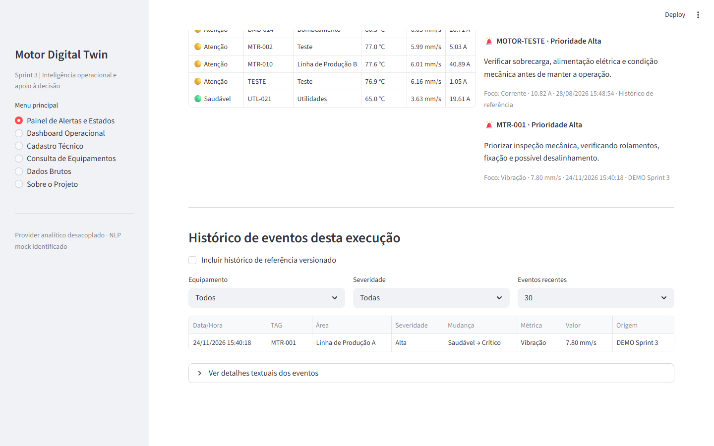  
*Comprova o registro único da transição `Saudável → Crítico` (`Vibração`, `7.80 mm/s`, `DEMO Sprint 3`) no histórico da execução e os cartões de prioridade operacional.*

---

### 2.2. Evolução até a apresentação final do Challenge e CP6 posterior

A rastreabilidade cronológica exige diferenciar com rigor três marcos distintos entre agosto e outubro de 2026:

**Figura 4 — Cronologia Real e Separação de Repositórios (2026)** · **Versão:** Sprints 1–3 (`3da6303`), `Forzy-Project` (`04c7dc5` / `7317f92`) e CP6 (`b4894fe`) · **Origem:** Histórico Git auditado em `SPRINT-FrontEND` e `Forzy-Project`  
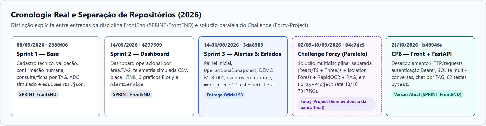  
*Comprova a linha do tempo entre as entregas da disciplina de FrontEnd e o desenvolvimento paralelo do Challenge integrado.*

#### 1. Entrega oficial da Sprint 3 da disciplina FrontEnd (`3da6303`, 31/08/2026)

Corresponde ao estado auditado na Seção 2.1, gravado no vídeo [`https://youtu.be/_mkTfZE0Fd8`](https://youtu.be/_mkTfZE0Fd8) e mantido em processo único Streamlit. No repositório `SPRINT-FrontEND`, **não existem commits entre `31/08/2026` (`3da6303`) e `21/10/2026`**.

#### 2. Evolução até a apresentação final do Challenge Forzy (setembro/2026 — repositório paralelo `Forzy-Project`)

Em paralelo à disciplina de FrontEnd, o Grupo 9 conduziu a solução multidisciplinar integrada no repositório separado [`Danylukk/Forzy-Project`](https://github.com/Danylukk/Forzy-Project), construído com outra stack (**React 19 + TypeScript + Tailwind v4 + Three.js + FastAPI + Isolation Forest + RapidOCR + Supabase/pgvector + OpenAI**) para o motor real `M-103`:

- **Banca intermediária (02/09/2026):** documentada em `Forzy-Project/docs/feedback/Feedback_Apresentacao_Challenge_Grupo9.pdf`, evidenciando a apresentação de protótipo React/3D integrado à API de telemetria da Forzy e recomendações dos avaliadores (substituir alertas por limiar fixo por modelo de ML, conectar o 3D da planta à API, mostrar OCR de placa, formalizar hierarquia `Planta → Área → Ativo → Sensor` e agregar datasheet do sensor ao RAG).
- **Evolução de preparação para a banca final (03/09 a 10/09/2026):** o plano `docs/plano-acao-apresentacao-final.md` registrou a meta da apresentação final para a semana de `07/09/2026`; commits em `Forzy-Project` entre `04/09` e `10/09/2026` (até `04c7dc5`) e o material `APRESENTACAO_FEATURES.pdf` / `TOUR_DAS_FEATURES.md` (prints de `09/09/2026`) implementaram o pipeline Isolation Forest, OCR com RapidOCR, planta 3D conectada e sala de controle. Posteriormente, em `18/10/2026` (`7317f92`), houve correções adicionais de segurança e calibração.
- **Limitação declarada sobre a banca final:** **não existem nos repositórios auditados evidências específicas da sessão efetiva da banca final de setembro** (como gravação da apresentação à banca, ata ou feedback escrito pós-banca final, nem tag de release fixando o commit exato executado ao vivo no dia da apresentação). Portanto, registra-se o intervalo evolutivo documentado em `Forzy-Project`, sem atribuir à apresentação de setembro nenhuma funcionalidade do CP6 construída em outubro no projeto Streamlit.

#### 3. Evolução posterior da disciplina de FrontEnd no CP6 (`f4fcc43` a `b4894fe`, 21/10/2026)

Em **21/10/2026** (entrega registrada para `25/10/2026`), o projeto Streamlit da disciplina (`SPRINT-FrontEND`) recebeu sua evolução arquitetural do **CP6**, consolidando todas as Sprints 1–3 e o novo **Assistente IA** em uma arquitetura desacoplada orientada ao FrontEnd:

- **Separação FrontEnd / BackEnd (`f4fcc43`, `731b3aa`, `e091d3c`):** a interface migrou para `frontend/` (porta `8501`) e passou a consumir exclusivamente a API REST em `backend/` (porta `8000`) via HTTP/`requests`, mantendo `app.py` na raiz como atalho compatível (`runpy`). Um teste automatizado via AST assegura que `frontend/` não importa `src/`, `app`, `backend` ou `sqlite3`.
- **Navegação unificada e sessão autenticada (`frontend/app.py`, `login.py`, `shell.py`):** adoção de `st.navigation` organizando 8 módulos em 3 grupos (`Monitoramento`, `Equipamentos`, `Assistente e projeto`), precedidos por tela de autenticação (`Entrar` / `Criar conta`) com verificação inicial de `/health`, exibição da conta logada e botão `Sair` para revogação da sessão.
- **Cliente HTTP centralizado e resiliência na UI (`frontend/services/api_client.py`, `components/session.py`):** `APIClient` encapsula URL base, timeout configurável (`API_TIMEOUT_SECONDS`, padrão `15s`), header `Authorization: Bearer <token>` e tradução de falhas de rede, timeouts, `401`, `404`, `409`, `422` e `503` em mensagens amigáveis sem traceback e sem retry automático em requisições `POST`.
- **Assistente IA integrado pela TAG (`frontend/ui_pages/chat.py`, `motor.py`, `navigation.py`):** permite criar, listar e retomar múltiplas conversas privadas persistidas no servidor por conta autenticada. Na `Consulta de Equipamentos` e no `Dashboard Operacional`, o botão **`Conversar sobre {tag}`** cria uma conversa e consulta automaticamente o estado atual do ativo com o mesmo `reading_id` do painel.
- **Correções visuais e de gráficos (`frontend/.streamlit/config.toml`, `motor_alerts.py`, `aa6b4ff`):** definição explícita do tema claro em `config.toml`, correção de contraste nos cards de alerta (`#f8fafc` sobre `#0f172a`) e ajuste de `plot_bgcolor="#F8FAFC"`, `font_color="#0F172A"` e `use_container_width=True` nos gráficos Plotly (commit `aa6b4ff`).
- **Ampliação de cobertura de testes e preservação de regras:** `src/` e `data/` permaneceram preservados e reaproveitados pelo backend (com `FleetRepository` isolando novos cadastros em `data/runtime/equipments.json`), enquanto a suíte cresceu de 12 para 62 testes (`pytest`).

---

### 2.3. Comparativo antes e depois

#### Tabela 2 — Comparativo entre Sprint 3 (`3da6303`) e Versão Atual / CP6 (`b4894fe`)

| Aspecto | Sprint 3 (`3da6303`) | Versão posterior / CP6 (`b4894fe`) | Benefício para o FrontEnd e operação | Evidência |
|---|---|---|---|---|
| Arquitetura | Monolito Streamlit importando `src/` diretamente. | FrontEnd Streamlit (`frontend/`) e BackEnd FastAPI (`backend/`) em processos separados. | FrontEnd restrito à apresentação e consumo HTTP, facilitando manutenção e evolução independente. | `frontend/app.py`, `test_frontend_does_not_import_backend_or_access_persistence` |
| Comunicação | Chamadas Python diretas em memória. | Exclusivamente HTTP/JSON via `APIClient` (`requests`), com timeout e sem retry em `POST`. | Fronteira de contrato explícita e prevenção contra gravações duplicadas após timeout. | `frontend/services/api_client.py`, `tests/test_cp6_client.py` |
| Autenticação | Inexistente; acesso direto ao painel. | Abas `Entrar` / `Criar conta`, token `Bearer` de sessão com TTL e botão `Sair` com revogação. | Controle de acesso às rotas `/motor/*` e `/conversas/*` com contexto de usuário visível. | `frontend/ui_pages/login.py`, `components/shell.py`, `test_cp6_api.py` |
| Navegação e Tema | `st.radio` com 6 páginas; sem `.streamlit/config.toml`; contraste falho nos cards de alerta. | `st.navigation` com 8 módulos em 3 grupos; tema claro explícito; card `#0f172a` com texto `#f8fafc`. | Fluxo hierárquico claro, nova página inicial `Dashboard` e leitura nítida dos alertas. | `frontend/.streamlit/config.toml`, `motor_alerts.py`, Figura 5 |
| Gráficos Plotly | `template="plotly_dark"` com fundo translúcido e `width="stretch"`. | `plot_bgcolor="#F8FAFC"`, `font_color="#0F172A"` e `use_container_width=True` (`aa6b4ff`). | Integração visual com o tema claro e remoção de avisos de configuração do Plotly. | `frontend/components/motor_details.py`, commit `aa6b4ff`, Figura 6 |
| Persistência na UI e dados | `equipments.json` alterado direto; histórico de conversas inexistente. | Seed intacto (novos cadastros em `data/runtime/`); múltiplas conversas privadas em SQLite por conta. | Preserva referências versionadas e permite retomar atendimentos por usuário entre sessões. | `backend/app/repositories/fleet.py`, `test_persistence_after_application_restart` |
| Assistente | Templates `mock_nlp` apenas em cards estáticos. | `Assistente IA` multi-conversa por regras (`motor-assistant-rules-v1`) com botão `Conversar sobre {tag}`. | Operador consulta qualquer TAG em linguagem natural mantendo o mesmo `reading_id` do painel. | `frontend/ui_pages/chat.py`, `motor.py`, Figura 7 |
| Tratamento de erros | `RepositoryDataError` apenas na página principal. | Mapeamento amigável de rede offline, timeout, `401`, `404`, `409`, `422` e `503` sem traceback. | Interface permanece estável e orienta o operador (`Tentar novamente` / novo login). | `frontend/components/session.py`, Figura 14 |
| Testes automatizados | 12 testes unitários (`unittest`). | 62 testes (`pytest`: API, cliente HTTP, integração motor e regressão Sprint 3). | Garante contratos HTTP, isolamento de contas e preservação das regras anteriores. | Reexecução em 24/11/2026 (`12/12` S3; `62/62` CP6) |

**Figura 5 — Comparativo Antes/Depois: Painel de Alertas e Estados (`MTR-001` em DEMO Crítico)** · **Versões:** Sprint 3 (`3da6303`) vs. Versão Atual / CP6 (`b4894fe`) · **Origem:** Montagem vertical com capturas reais de 24/11/2026 (`1440×900`)  
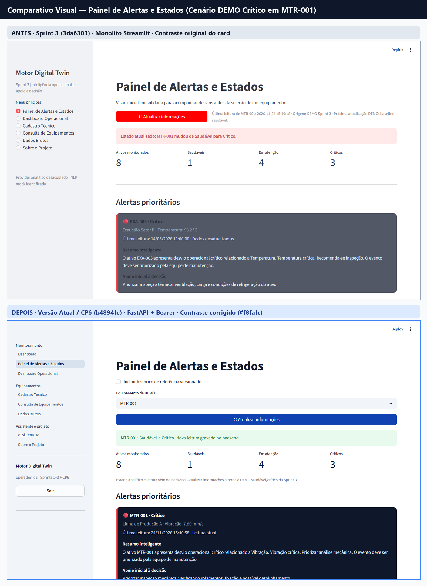  
*Em largura total, evidencia a transição de `st.radio` para `st.navigation` agrupada com botão `Sair`, adição do seletor de ativo na DEMO e correção de legibilidade dos cabeçalhos internos do card escuro (`#f8fafc` sobre `#0f172a`).*

**Figura 6 — Comparativo Antes/Depois: Dashboard Operacional e Gráficos Plotly (`MTR-001`)** · **Versões:** Sprint 3 (`3da6303`) vs. Versão Atual / CP6 (`b4894fe`) · **Origem:** Montagem vertical com capturas reais de 24/11/2026 (`1440×900`)  
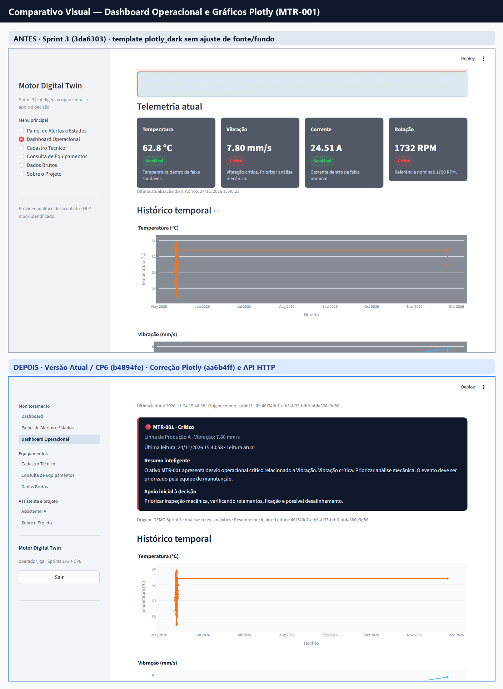  
*Comprova a inclusão do card de estado `MTR-001 · Crítico` sincronizado pelo mesmo `reading_id` acima da série histórica e a correção visual de fundo (`#F8FAFC`) e fonte (`#0F172A`) nos gráficos Plotly (commit `aa6b4ff`).*

**Figura 7 — Comparativo Funcional: Ficha Técnica Isolada vs. Assistente Contextualizado pela TAG** · **Versões:** Sprint 3 (`3da6303`) vs. Versão Atual / CP6 (`b4894fe`) · **Origem:** Montagem vertical com capturas reais de 24/11/2026 (`1440×900`)  
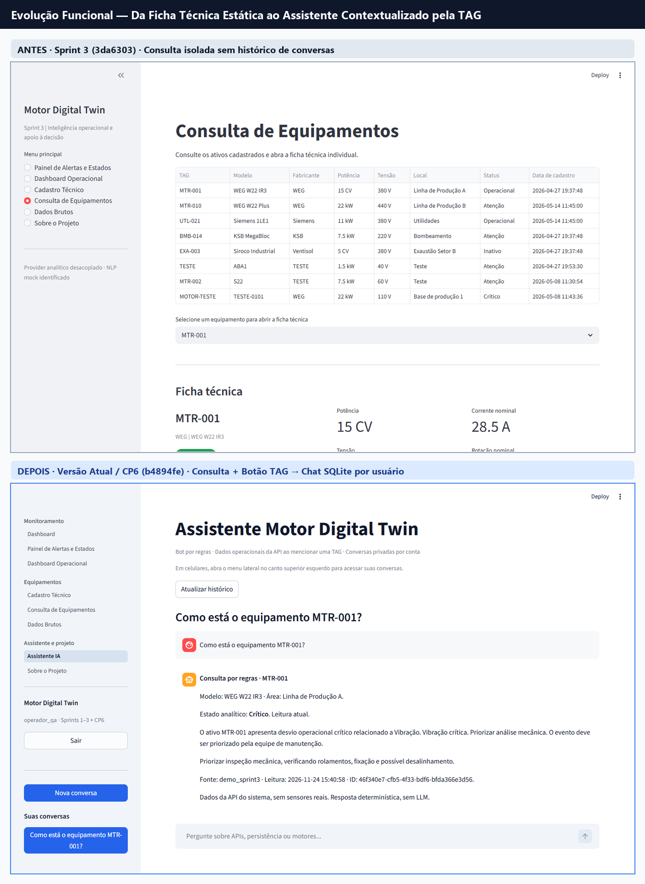  
*Evidencia a evolução de uma ficha técnica estática na Sprint 3 para um fluxo integrado em que o botão `Conversar sobre MTR-001` abre conversa privada persistida com os mesmos dados da API (`demo_sprint3`, `Crítico`, `reading_id`).*

---

### 2.4. Rastreabilidade

#### Tabela 3 — Histórico integral de commits do repositório `SPRINT-FrontEND`

| Commit | Data | Autor | Descrição | Marco / Papel | Link |
|---|---|---|---|---|---|
| `2388f06` | 2026-05-08 | Thiago Danlyuk | `first commit` | Base da Sprint 1 (cadastro, consulta, ficha, dados brutos) | [commit](https://github.com/Danylukk/SPRINT-FrontEND/commit/2388f066b440d6e850c845d7903cf21fe226e245) |
| `4277509` | 2026-05-14 | Thiago Danlyuk | `Sprint 2 - evolui dashboard operacional de ativos` | Dashboard operacional, telemetria CSV, Plotly, placa e `AlertService` | [commit](https://github.com/Danylukk/SPRINT-FrontEND/commit/4277509c5ffaf8b2e3355778e2db44c462c9822d) |
| `8450acc` | 2026-08-14 | Thiago Danlyuk | `feat: implementa inteligencia operacional da Sprint 3` | Primeira versão da camada analítica, eventos e painel da Sprint 3 | [commit](https://github.com/Danylukk/SPRINT-FrontEND/commit/8450acc2526253b1d0c4e3475fd1cf184930ef36) |
| `376ebe3` | 2026-08-14 | Thiago Danlyuk | `chore: ignora historico de eventos gerado em runtime` | Ajuste de `.gitignore` para eventos runtime | [commit](https://github.com/Danylukk/SPRINT-FrontEND/commit/376ebe330cc914c9d00e75f79e9950a4eb1f7aec) |
| `31bcf0f` | 2026-08-28 | Thiago Danlyuk | `feat: adiciona histórico de eventos operacionais para monitoramento` | Inclusão do CSV seed inicial de eventos operacionais | [commit](https://github.com/Danylukk/SPRINT-FrontEND/commit/31bcf0fb32ee20962e1b6f7ae715fe8cd966d2e2) |
| **`3da6303`** | **2026-08-31** | **Thiago Danlyuk** | **`feat: finalize Sprint 3 alerts and operational states`** | **Referência oficial da Sprint 3 (`AnalyticsProvider`, fail-closed, 12 testes)** | [commit](https://github.com/Danylukk/SPRINT-FrontEND/commit/3da6303304bc29accc307d6356c8b9733da256d1) |
| `f4fcc43` | 2026-10-21 | Thiago Danlyuk | `feat(api): adiciona chat CP6 com autenticacao e historico SQLite` | API FastAPI + autenticação Bearer + SQLite + `test_cp6_api.py` | [commit](https://github.com/Danylukk/SPRINT-FrontEND/commit/f4fcc4340d36187975e0e3e8f2853e42e8a872c7) |
| `731b3aa` | 2026-10-21 | Thiago Danlyuk | `feat(frontend): implementa chat Streamlit com cliente HTTP e navegacao` | FrontEnd Streamlit CP6 + `APIClient` + `test_cp6_client.py` | [commit](https://github.com/Danylukk/SPRINT-FrontEND/commit/731b3aafd5e8c08538daa9cdc484a7995f5d1dd8) |
| `d658437` | 2026-10-21 | Thiago Danlyuk | `docs(cp6): documenta entrega, integrantes e video de demonstracao` | README CP6, `ROTEIRO_CP6.md`, `SPRINT3.md`, prints e vídeo iniciais | [commit](https://github.com/Danylukk/SPRINT-FrontEND/commit/d658437f4e12308e8cc4f02cf7bce1e3d22de6f7) |
| `e091d3c` | 2026-10-21 | Thiago Danlyuk | `feat: integra as sprints e o chat em um unico Motor Digital Twin` | Integração completa de Sprints 1–3 na API `/motor/*` e na UI Streamlit (+25 arquivos) | [commit](https://github.com/Danylukk/SPRINT-FrontEND/commit/e091d3c144574f30f647e0e9871df5a232b224dd) |
| `a717719` | 2026-10-21 | Thiago Danlyuk | `docs: atualiza README e video para demonstrar o sistema completo` | Documentação e imagem `docs/sistema-integrado.png` | [commit](https://github.com/Danylukk/SPRINT-FrontEND/commit/a7177194d41464feb77bafb21afabd1076dffa2e) |
| `aa6b4ff` | 2026-10-21 | Thiago Danlyuk | `fix: renderiza graficos sem avisos de configuracao do Plotly` | Correção de `st.plotly_chart(..., use_container_width=True)` em `motor_details.py` | [commit](https://github.com/Danylukk/SPRINT-FrontEND/commit/aa6b4fffcde7dfc4929fc1adf4b9ea7aed967d5f) |
| **`b4894fe`** | **2026-10-21** | **Thiago Danlyuk** | **`docs: finaliza video integrado com graficos e fluxo completo validados`** | **Último commit na `main` (comparação oficial `3da6303...b4894fe`)** | [commit](https://github.com/Danylukk/SPRINT-FrontEND/commit/b4894fe2adea5cf4a962a573b1a5fad7c0080018) |

Comparação completa entre versões: [`3da6303...b4894fe`](https://github.com/Danylukk/SPRINT-FrontEND/compare/3da6303...b4894fe). Nenhum arquivo de `src/` ou `data/` foi modificado nesse intervalo, confirmando a preservação integral das regras originais.

Trechos de código representativos da fronteira do FrontEnd:

1. **Ação contextual da ficha/dashboard para o Assistente (`frontend/ui_pages/motor.py`, linhas 33–43):**

```python
def talk_about(client, equipment):
    if st.button(f"Conversar sobre {equipment.tag}", type="primary"):
        conversation = client.create_conversation()
        st.session_state.conversa_ativa = conversation["id"]
        try:
            client.send_message(conversation["id"], f"Como está o equipamento {equipment.tag}?")
        except APIError as error:
            st.session_state["chat_notice"] = str(error)
            open_chat()
        open_chat()
```

2. **Tratamento centralizado e amigável de erros HTTP no cliente (`frontend/services/api_client.py`, linhas 40–54):**

```python
if not response.ok:
    defaults = {401: "Sessão inválida ou expirada. Entre novamente.", ...}
    if path.startswith("/motor/"):
        defaults.update({404: "Equipamento não encontrado.", 409: "Essa TAG já está cadastrada.", ...})
    raise APIError(defaults.get(response.status_code, "A API não conseguiu concluir a operação."),
                   response.status_code)
```

---

## 3. Diferenciais e resultados da solução

### 3.1. Experiência do usuário (UX)

- **Navegação agrupada e controle de sessão:** `st.navigation` organiza os 8 módulos em `Monitoramento`, `Equipamentos` e `Assistente e projeto`, mantendo a identidade logada e o botão `Sair` acessíveis no rodapé da barra lateral (`components/shell.py`).
- **Hierarquia visual orientada à triagem:** o `Painel de Alertas e Estados` apresenta primeiro os KPIs da frota, seguidos por até 4 cards prioritários ordenados por severidade (`Crítico → Atenção → Indisponível → Saudável`), tabela completa de estados, bloco de ação sugerida e histórico de eventos filtrável.
- **Cores semânticas e correção de contraste:** verde (`#22c55e` / `#1f9d55`) indica *Saudável / Operacional*, âmbar (`#f59e0b` / `#d99a00`) indica *Atenção*, vermelho (`#ef4444` / `#c92a2a`) indica *Crítico* e cinza ardósia (`#94a3b8`) indica *Indisponível*. A atualização do CP6 definiu fundo `#0f172a` com texto `#f8fafc` explícito nos cards de alerta, corrigindo o baixo contraste visto na Sprint 3 (Figura 5).
- **Neutralidade de estado:** leituras com mais de 120 minutos exibem `"Dados desatualizados"` e valores ausentes/não finitos exibem `"Indisponível"`, evitando alarmes críticos falsos.
- **Prevenção de erros e feedback claro:** cadastro exige confirmação humana explícita (`confirmar`); limpeza do formulário exige confirmação independente; erros HTTP (`401`, `404`, `409`, `422`, `503`), timeouts e API desligada mostram avisos claros com ações seguras (`Tentar novamente` ou retorno ao login), sem expor tracebacks e sem repetir gravações `POST` automaticamente.
- **Gráficos e responsividade mobile:** séries temporais em Plotly distinguem temperatura (`#f97316`), vibração (`#38bdf8`) e corrente (`#22c55e`) sobre fundo claro (`aa6b4ff`). A visualização mobile foi validada em `390×844` (Figura 8), sem estouro horizontal e com menu lateral acessível pelo ícone superior esquerdo.
- **Ressalva de acessibilidade:** embora existam boas práticas pontuais (`role="img"` e `aria-label` na placa simulada), **não foi realizada auditoria formal WCAG 2.2** com leitor de tela, e permanecem pontos herdados em `frontend/components/motor.py` (fallback de `HEALTH_STYLES` para `"Atenção"` em estado `"Indisponível"`, cor vermelha compartilhada entre `"Inativo"` e `"Crítico"`, e baixo contraste em `.operational-message`).

**Figura 8 — Visualização Responsiva Mobile do Assistente (`390×844`)** · **Versão:** Versão Atual / CP6 (`b4894fe`) · **Origem:** Captura real em `127.0.0.1:8514` executada em 24/11/2026 (`390×844`)  
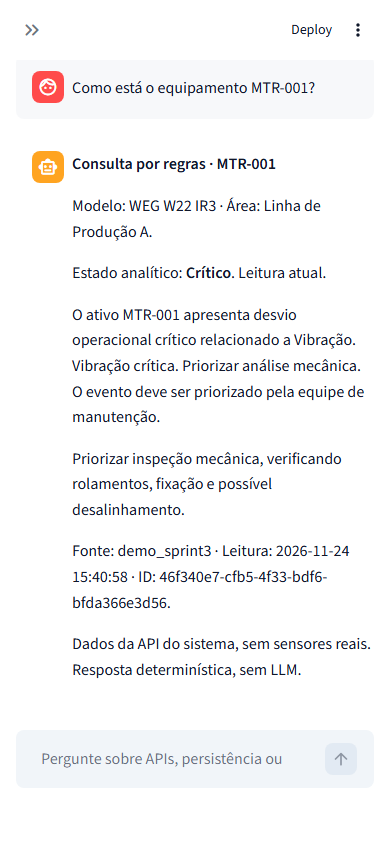  
*Exibida em escala ampliada para leitura direta sem zoom: comprova a adaptação da conversa contextualizada de `MTR-001` em tela de smartphone (`390×844`), preservando integridade do `reading_id`, quebra de linha e acessibilidade ao menu lateral.*

---

### 3.2. Diferenciais técnicos de FrontEnd e integração

- **Componentização e isolamento de camadas:** `frontend/ui_pages/` (orquestração de telas), `frontend/components/` (componentes visuais reutilizáveis e controle de sessão), `frontend/navigation.py` (roteamento contextual) e `frontend/services/api_client.py` (ponto único HTTP). O teste de AST comprova que o FrontEnd não acessa diretamente `src/`, `backend/` ou `sqlite3`.
- **Contratos e sincronização entre telas:** a UI consome DTOs JSON padronizados pela API, garantindo que `Painel de Alertas e Estados`, `Dashboard Operacional` e `Assistente IA` exibam o mesmo `OperationalSnapshot`, origem (`source`) e `reading_id`.
- **Reaproveitamento sem duplicação:** todas as regras das Sprints 1–3 (`AlertService`, `RulesAnalyticsProvider`, `NLPSummaryService`, fórmulas de `sensor_service` e separação seed vs. `data/runtime/`) foram mantidas no servidor sem reimplementação no cliente.
- **Estado transitório limpo:** o cliente mantém na `st.session_state` apenas token Bearer, identidade do usuário, conversa selecionada e chaves transitórias de formulários; históricos de mensagens e telemetria são sempre obtidos via HTTP.
- **Transparência acadêmica contínua:** todas as telas, legendas e respostas do assistente informam explicitamente que sensores, leituras e análises são simulados/determinísticos.

---

### 3.3. Jornada do usuário

**Figura 9 — Jornada Operacional do Usuário e Fluxo de Requisição Autenticada** · **Versão:** Versão Atual / CP6 (`b4894fe`) · **Origem:** Diagrama técnico elaborado a partir de `frontend/ui_pages/` e `backend/app/`  
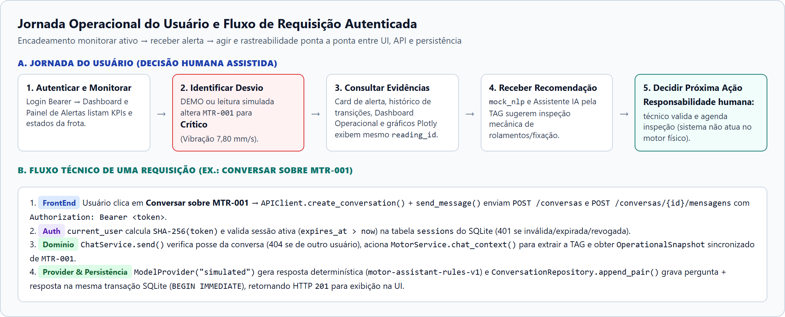  
*Representa o encadeamento completo da operação assistida na interface e a trilha HTTP autenticada até o retorno ao usuário.*

Na jornada validada ponta a ponta em 24/11/2026:

1. **Autenticar e monitorar:** o operador cria conta/entra na aba `Entrar` (Figura 10) e visualiza o `Dashboard` consolidado ou o `Painel de Alertas e Estados`.
2. **Receber alerta por desvio:** ao acionar `↻ Atualizar informações` para `MTR-001` no `Painel de Alertas e Estados` (Figura 11), uma nova leitura `demo_sprint3` (`7.80 mm/s` de vibração) altera o estado de `Saudável → Crítico`, atualiza os KPIs (`1` saudável / `3` críticos) e registra o evento de transição uma única vez.
3. **Consultar evidências:** no `Dashboard Operacional` (Figura 12), ao filtrar `Linha de Produção A` / `MTR-001`, a tela exibe o mesmo estado `Crítico`, mesma origem e mesmo `reading_id` (`46f340e7-cfb5-4f33-bdf6-bfda366e3d56`), acompanhados dos gráficos Plotly e da placa simulada.
4. **Consultar recomendação pela TAG:** clicando em `Conversar sobre MTR-001`, o `Assistente IA` abre uma nova conversa persistida (Figura 13) repetindo exatamente o estado `Crítico`, timestamp e `reading_id`, com recomendação inicial de inspeção mecânica.
5. **Agir (decisão humana):** **toda decisão operacional permanece sob responsabilidade humana**; o sistema não executa manutenção física, não aciona equipamentos nem abre ordens de serviço automáticas.

**Figura 10 — Tela de Autenticação (`Entrar` / `Criar conta`) com Verificação de `/health`** · **Versão:** CP6 (`b4894fe`) · **Origem:** Captura real em `127.0.0.1:8514` em 24/11/2026 (`1440×900`)  
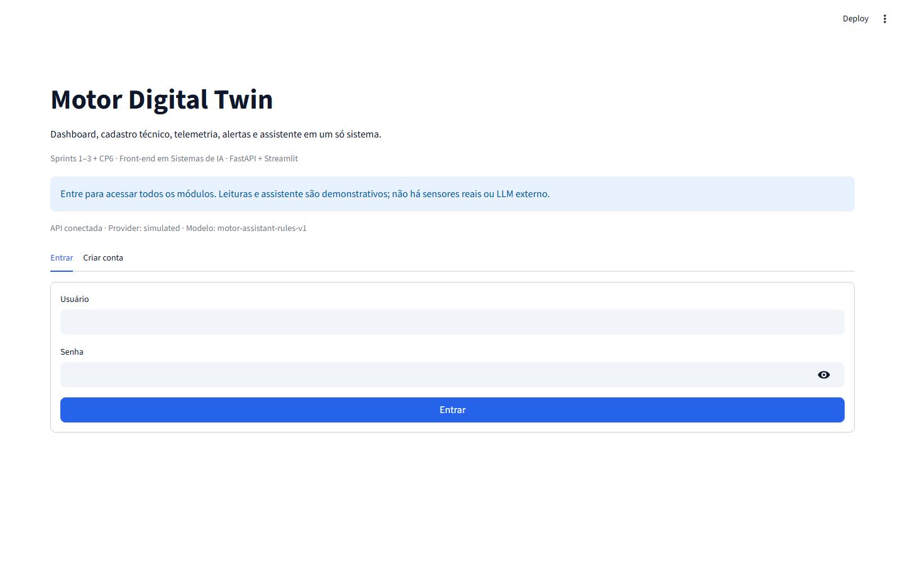  
*Comprova o bloqueio inicial de módulos antes da autenticação, a leitura de `GET /health` (`provider: simulated`, `modelo: motor-assistant-rules-v1`) e o fluxo de entrada/cadastro.*

**Figura 11 — Painel de Alertas e Estados após DEMO Crítico em `MTR-001`** · **Versão:** CP6 (`b4894fe`) · **Origem:** Captura real em `127.0.0.1:8514` em 24/11/2026 (`1440×900`)  
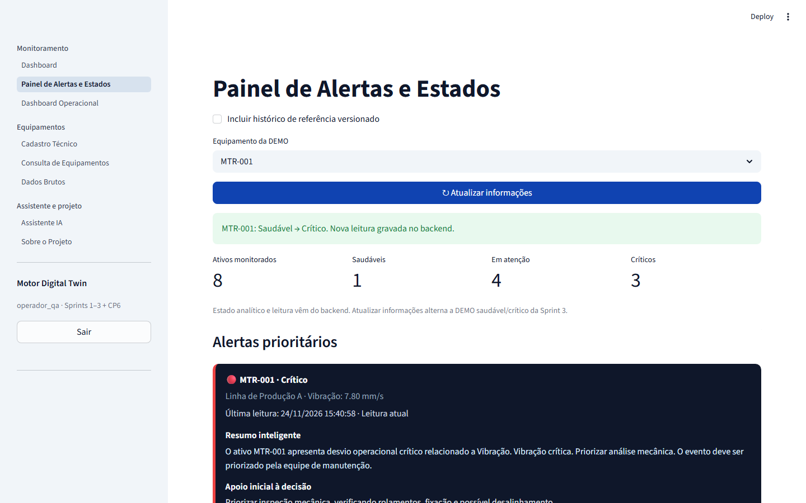  
*Comprova a atualização dos KPIs (`8` monitorados, `1` saudável, `4` em atenção, `3` críticos), a mensagem de transição `MTR-001: Saudável → Crítico` e a legibilidade do card corrigido.*

**Figura 12 — Dashboard Operacional e Gráficos Plotly Corrigidos (`MTR-001`)** · **Versão:** CP6 (`b4894fe`) · **Origem:** Captura real em `127.0.0.1:8514` em 24/11/2026 (`1440×900`)  
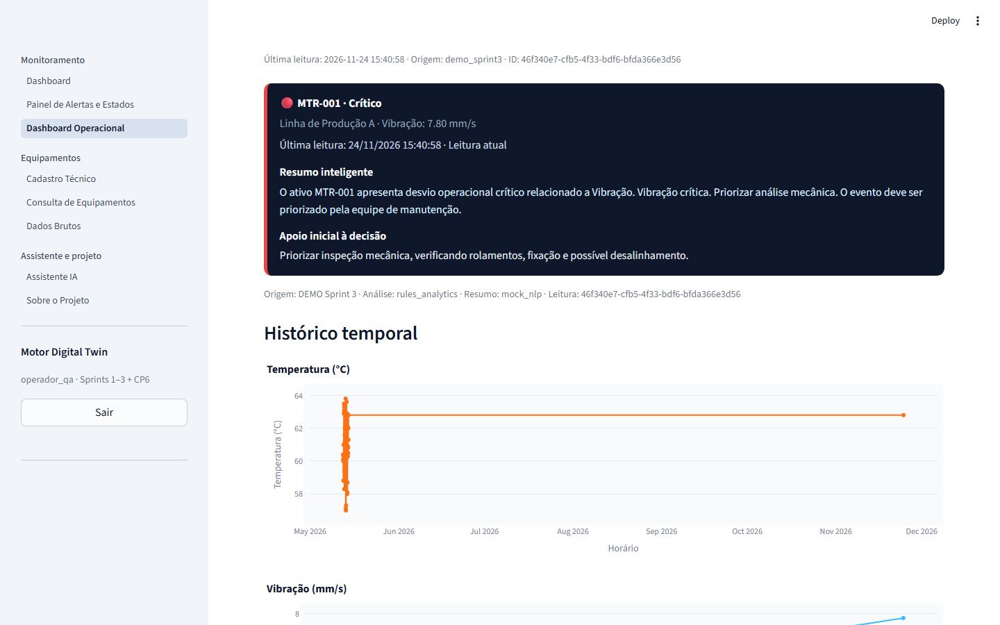  
*Comprova a consistência do `reading_id` `46f340e7-cfb5-4f33-bdf6-bfda366e3d56` com o painel de alertas e a renderização limpa do gráfico de temperatura com fundo `#F8FAFC` e fonte `#0F172A`.*

**Figura 13 — Assistente IA Contextualizado pela TAG e Histórico Persistido** · **Versão:** CP6 (`b4894fe`) · **Origem:** Captura real em `127.0.0.1:8514` em 24/11/2026 (`1440×900`)  
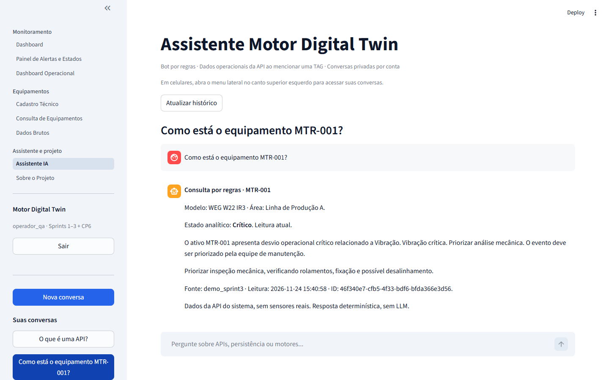  
*Comprova a consulta pela TAG `MTR-001` com idêntico `reading_id`, listagem de múltiplas conversas privadas na barra lateral (`O que é uma API?` e `Como está o equipamento MTR-001?`) e retomada via HTTP.*

---

### 3.4. Resultados alcançados

#### Tabela 4 — Classificação dos resultados de testes e validações

| Verificação | Escopo | Resultado histórico documentado | Resultado reexecutado (24/11/2026) | Observações e limitações |
|---|---|---|---|---|
| `python -m unittest discover -s tests -v` (Sprint 3 `3da6303`) | Regras de limiar, DEMO `MTR-001`, transições, rerun, recuperação, `NaN`, estado adm., seed/runtime e falhas JSON/CSV. | 12 testes aprovados (documentado na entrega da Sprint 3). | **12/12 aprovados em 0,319 s** (worktree isolado `3da6303`). | Nenhum teste ignorado. |
| `python -m pytest -v` (Versão Atual `b4894fe`) | API CP6 (`test_cp6_api.py`), cliente HTTP (`test_cp6_client.py`), integração motor (`test_motor_api.py`) e regressão Sprint 3 (`test_sprint3.py`). | 62 testes aprovados em 21/10/2026 (`README.md`, Python 3.12.14). | **62/62 aprovados em 27,40 s** em Python 3.14.3. | Nenhum teste ignorado; ambiente local utiliza versões de pacotes mais novas que `requirements.txt` (`fastapi 0.137.2`, `streamlit 1.57.0`, `pandas 3.0.2`). |
| `python -m compileall -q` | Compilação de sintaxe Python (`app.py`, `src`, `tests`, `backend`, `frontend`). | Aprovado em 21/10/2026. | **Aprovado (código de saída 0)** em ambas as versões. | — |
| `python -m pip check` | Integridade das dependências instaladas no ambiente. | Aprovado em 21/10/2026. | **Aprovado (`No broken requirements found.`)**. | Verificado no ambiente Python 3.14.3. |
| Jornada E2E no navegador (Playwright Chromium, `1440×900` e `390×844`) | Contas `operador_qa` e `auditor_qa`, login 401/200, cadastro 422, DEMO, gráficos, chat TAG, retomada, isolamento entre contas, API offline, provider 503 e mobile. | Validado manualmente em 21/10/2026 com gravação `docs/video-cp6.mp4` sem erros de console. | **Validado com 0 erros de console** (`s3_console_errors=[]`, `cp6_console_errors=[]`). | Na checagem automatizada de `Dados Brutos`, a string `"1023"` não apareceu no `innerText` do DOM porque `st.dataframe` renderiza células em `<canvas>`; a conversão foi validada por `test_raw_sensor_conversion_and_missing_equipment`. |

**Figura 14 — Documentação Interativa da API (`/docs`)** · **Versão:** CP6 (`b4894fe`) · **Origem:** Captura real em `127.0.0.1:8014/docs` em 24/11/2026 (`1440×900`)  
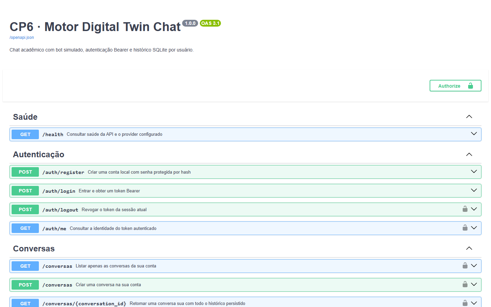  
*Comprova a publicação automática dos contratos OpenAPI 3.1 com esquema `HTTPBearer` (`Authorize`).*

**Figura 15 — Tratamento Amigável de Erro com API Offline** · **Versão:** CP6 (`b4894fe`) · **Origem:** Captura real em `127.0.0.1:8514` em 24/11/2026 (`1440×900`)  
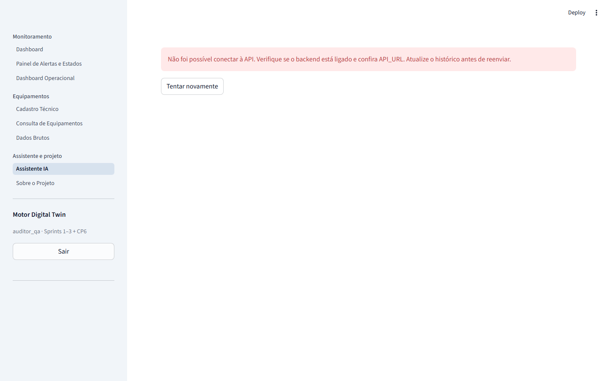  
*Comprova que, mesmo com o backend desligado, o FrontEnd preserva a navegação e exibe mensagem amigável e botão `Tentar novamente` sem traceback.*

---

### 3.5. Atendimento ao Challenge Forzy

Sob a ótica da disciplina de **FrontEnd**, o repositório `SPRINT-FrontEND` atende ao problema proposto no Challenge Forzy nos seguintes pilares **demonstrados em ambiente acadêmico**:

1. **Centralização de informações:** consolida ficha técnica, especificações nominais, observações e dados brutos simulados por TAG única.
2. **Acompanhamento da condição operacional:** reúne KPIs de frota, séries temporais e leitura atual rastreável em um único sistema web.
3. **Identificação visual de desvios:** ordena e destaca estados *Crítico* e *Atenção* com cores semânticas, separando leituras desatualizadas ou inválidas de anomalias.
4. **Consulta de histórico:** registra transições reais de estado (`status_before → status_after`) e mantém histórico conversacional privado por operador.
5. **Apoio inicial à decisão:** entrega recomendações determinísticas (`mock_nlp` / `motor-assistant-rules-v1`) vinculadas à leitura vigente da TAG para orientar inspeções humanas.

> **Distinção obrigatória:** Esses resultados foram demonstrados sobre dados locais e simulados; eventuais benefícios industriais futuros (redução de paradas não planejadas ou ganhos operacionais) exigem instrumentação real e validação em campo, não existindo percentuais medidos neste projeto. A solução multidisciplinar paralela do Challenge encontra-se em [`Danylukk/Forzy-Project`](https://github.com/Danylukk/Forzy-Project) (React/TS + Three.js + FastAPI + Isolation Forest + RapidOCR + RAG vetorial para o motor `M-103`).

---

## 4. Pendências, justificativas e melhorias futuras

A auditoria técnica identificou onze pendências reais no repositório `SPRINT-FrontEND`. Quando o motivo não consta registrado em commits ou documentos do projeto, indica-se que a causa não foi documentada formalmente, acompanhada da análise técnica baseada no código.

#### Tabela 5 — Matriz de pendências, justificativas e melhorias priorizadas

| Pendência | Estado atual | Justificativa comprovada ou limitação | Proposta de melhoria | Prioridade | Complexidade |
|---|---|---|---|---|---|
| Integração com sensores reais (ESP32 / MQTT / API industrial) | Não implementada; leituras e ADC são simulados localmente. | Decisão explícita de escopo acadêmico nas Sprints 1–3 e CP6 (`README.md` e `pages.py` registram que simulações validam a UI antes do hardware; sensores reais foram integrados apenas no repo paralelo `Forzy-Project`). | Criar conector de ingestão no backend mantendo o mesmo contrato JSON de leitura (`source="iot_sensor"`) sem alterar o FrontEnd. | **P0** | Alta |
| Escalabilidade da persistência operacional | JSON/CSV locais sob trava de processo único Uvicorn; chat em SQLite local. | Documentado em `README.md` (linha 160): demonstração acadêmica restrita a 1 processo Uvicorn; múltiplos workers causariam conflito em arquivos locais e cache de snapshots em memória. | Migrar dados operacionais para banco relacional/séries temporais, removendo estado em memória e habilitando múltiplos workers. | **P0** | Média |
| Endurecimento de autenticação para produção | Autenticação Bearer local funcional, sem controle de registro, recuperação de senha, rate limit, RBAC ou API Key. | Escopo delimitado em `README.md` (linha 119): *"Cadastro de conta público é para demonstração acadêmica local; recuperação de senha, limites de tentativas e infraestrutura de uso público não integram esta entrega."* | Adicionar rate limiting no login, papéis (`operador`, `admin`), TLS via proxy reverso e suporte a `X-API-Key` para coletores automatizados. | **P0** | Média |
| Observabilidade (`trace_id` e headers de contexto) | Apenas log básico para erro SQLite; sem `trace_id` entre FrontEnd e API. | Causa não documentada formalmente. Análise técnica: o CP6 priorizou contratos HTTP, autenticação e tratamento básico de erros no prazo da entrega. | Propagar `X-Trace-ID`, `X-Client-Module` e `X-Equipment-Tag` pelo `APIClient` com middleware de logs JSON estruturados. | **P1** | Baixa |
| Machine Learning real na detecção de anomalias | Não implementada; classificação determinística via `RulesAnalyticsProvider` (`score=None`). | Decisão explícita de escopo e transparência acadêmica (`docs/SPRINT3.md`), preservando o protocolo `AnalyticsProvider` para troca futura (Isolation Forest existe apenas no repo paralelo `Forzy-Project`). | Implementar `MLAnalyticsProvider` treinado sobre histórico real, preenchendo `score` e mantendo fallback por regras. | **P1** | Alta |
| NLP generativo e RAG com manuais técnicos | Não implementados; respostas determinísticas (`mock_nlp` e `motor-assistant-rules-v1`). | Decisão explícita do CP6 (`README.md` linha 123: escolha do provider `simulated` para operar sem custo ou chave externa; RAG vetorial existe apenas no `Forzy-Project`). | Conectar provedor LLM com busca vetorial em manuais (citando fontes) e fallback determinístico em caso de falha. | **P1** | Alta |
| Atualização contínua da telemetria na UI | Atualização ocorre apenas sob demanda (cliques ou troca de rota). | Causa não documentada formalmente. Análise técnica: alinhado ao fluxo síncrono do Streamlit e à ausência de stream contínuo de sensores. | Adotar atualização periódica opcional (`st.fragment(run_every=...)`) com indicador visual de pausa/ao vivo. | **P1** | Média |
| Testes automatizados de interface (UI E2E) | Os 62 testes versionados em `tests/` cobrem domínio, API e `APIClient` via `Mock`, sem bateria E2E de navegador versionada. | Causa não documentada formalmente; o `.gitignore` inclui `playwright-report/` e `test-results/`, sugerindo testes exploratórios fora do versionamento. | Versionar suíte Playwright headless mínima (login, DEMO, chat TAG, erro offline) para execução contínua. | **P1** | Média |
| Acessibilidade (WCAG 2.2) e ajustes visuais legados | Sem auditoria WCAG formal; em `frontend/components/motor.py`, `"Indisponível"` cai em fallback `"Atenção"`, `"Inativo"` compartilha vermelho com `"Crítico"` e `.operational-message` tem baixo contraste. | Causa não documentada formalmente. Análise técnica: no CP6, os ajustes visuais focaram `motor_alerts.py` e `motor_details.py`, preservando `motor.py` herdado da Sprint 2. | Realizar auditoria de contraste e leitor de tela, definir estilo neutro para `"Indisponível"`/`"Inativo"` e adequar `.operational-message` ao tema claro. | **P2** | Baixa |
| Feedback do usuário sobre recomendações da IA | Não implementado; operador lê as respostas sem mecanismo de avaliação (`útil` / `não útil`). | Causa não documentada formalmente; o CP6 priorizou o fluxo mínimo de criação, envio e retomada de conversas. | Incluir botões discretos de avaliação vinculados ao ID da mensagem na interface e persistência da avaliação no backend. | **P2** | Baixa |
| Busca/paginação no Dashboard e unificação de estilos | `Dashboard` lista toda a frota sem filtro ou paginação; tokens de estilo divididos entre `motor.py` e `motor_alerts.py`. | Causa não documentada formalmente; base inicial reduzida (8 ativos seed) não demandou paginação. | Adicionar busca por TAG/área, paginação (`limit`/`offset`) e tokens visuais unificados no FrontEnd. | **P2** | Baixa |

---

## 5. Ir além — arquitetura orientada à produção

A arquitetura do **CP6** já estabelece a separação entre apresentação (`frontend/`), contrato HTTP/REST (`APIClient`) e serviços (`backend/`), permitindo evoluir para produção sem reescrever as telas.

**Figura 16 — Arquitetura Atual Desacoplada em Camadas (Versão Atual / CP6)** · **Versão:** CP6 (`b4894fe`) · **Origem:** Diagrama técnico conferido em `frontend/` e `backend/`  
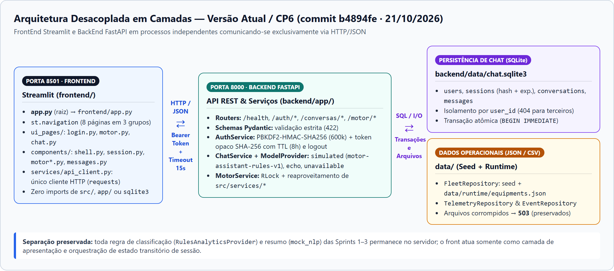  
*Evidencia a comunicação exclusiva via HTTP/JSON com token Bearer entre Streamlit (`8501`) e FastAPI (`8000`), mantendo o domínio das Sprints 1–3 isolado no servidor.*

#### Tabela 6 — Inventário conferido dos 16 endpoints existentes na API (`backend/app/routers/`)

| Método e rota | Router | Autenticação | Status HTTP | Responsabilidade para o FrontEnd |
|---|---|---|---|---|
| `GET /health` | `health.py` | Público | `200` | Verifica conectividade, provider e modelo antes do login. |
| `POST /auth/register` | `auth.py` | Público | `201`, `409`, `422` | Cria conta local com usuário (3–40 chars) e senha (8–128 chars). |
| `POST /auth/login` | `auth.py` | Público | `200`, `401`, `422` | Autentica usuário e retorna token Bearer e TTL de sessão. |
| `GET /auth/me` | `auth.py` | Bearer | `200`, `401` | Valida sessão ativa e retorna identidade do usuário. |
| `POST /auth/logout` | `auth.py` | Bearer | `204`, `401` | Revoga a sessão atual ao clicar em `Sair`. |
| `GET /conversas` | `conversations.py` | Bearer | `200`, `401` | Lista apenas as conversas privadas da conta autenticada. |
| `POST /conversas` | `conversations.py` | Bearer | `201`, `401`, `422` | Cria nova conversa vazia para o botão `Nova conversa` ou atalho por TAG. |
| `GET /conversas/{conversation_id}` | `conversations.py` | Bearer | `200`, `401`, `404`, `422` | Carrega mensagens persistidas ao retomar conversa (404 para terceiros). |
| `POST /conversas/{conversation_id}/mensagens` | `conversations.py` | Bearer | `201`, `401`, `404`, `422`, `503` | Envia mensagem, injeta contexto por TAG se citada e retorna resposta atômica. |
| `GET /motor/equipamentos` | `motor.py` | Bearer | `200`, `401`, `503` | Alimenta a tabela consolidada do `Dashboard` e seletores de TAG. |
| `POST /motor/equipamentos` | `motor.py` | Bearer | `201`, `401`, `409`, `422`, `503` | Salva novo equipamento em runtime mediante `confirmar=true` e TAG única. |
| `GET /motor/painel` | `motor.py` | Bearer | `200`, `401`, `503` | Alimenta KPIs, cards de alerta, tabela de estados e eventos do painel. |
| `GET /motor/equipamentos/{tag}` | `motor.py` | Bearer | `200`, `401`, `404`, `503` | Carrega ficha técnica, snapshot atual e histórico de 48 pontos para gráficos. |
| `POST /motor/equipamentos/{tag}/demo` | `motor.py` | Bearer | `201`, `401`, `404`, `503` | Executa alternância DEMO (`Saudável ↔ Crítico`) e retorna novo snapshot. |
| `POST /motor/equipamentos/{tag}/leituras` | `motor.py` | Bearer | `201`, `401`, `404`, `503` | Gera nova leitura simulada no `Dashboard Operacional`. |
| `GET /motor/equipamentos/{tag}/sensores` | `motor.py` | Bearer | `200`, `401`, `404`, `503` | Retorna tabela de valores ADC simulados e convertidos para `Dados Brutos`. |

### Proposta evolutiva de produção (sem implementação nesta Sprint)

Aproveitando o cliente centralizado `APIClient` e a separação já existente, propõe-se a seguinte evolução gradual — **não implementada no código atual**:

1. **Autenticação complementar por API Key (`X-API-Key`) para integrações M2M:** manter `Authorization: Bearer <token>` para sessões interativas de operadores no Streamlit e adicionar `X-API-Key` (armazenada por hash com escopo mínimo, ex.: `telemetry:write`) para ingestão automatizada por dispositivos ESP32/gateways sem fluxo de login humano.
2. **Observabilidade ponta a ponta (`X-Trace-ID` e headers de contexto):** estender o `APIClient` para enviar `X-Trace-ID` (UUID por interação), `X-Client-Module` (tela de origem) e `X-Equipment-Tag`; no FastAPI, um middleware propagaria o identificador nos logs JSON estruturados e no corpo de erro amigável (`ErrorResponse`), agilizando diagnóstico de falhas sem expor detalhes internos na UI.
3. **Feedback explícito do operador sobre respostas de IA:** adicionar endpoint `POST /conversas/{conversation_id}/mensagens/{message_id}/feedback` e controles discretos (`👍` / `👎`) abaixo das mensagens do assistente no `chat.py`, permitindo auditar a utilidade das recomendações antes da adoção de modelos generativos.
4. **Plano de migração em 3 fases sem ruptura da UI:** *(Fase A)* headers de contexto, `X-Trace-ID`, rate limiting no login e feedback no SQLite; *(Fase B)* migração dos repositórios JSON/CSV/SQLite para banco gerenciado (PostgreSQL/TimescaleDB) mantendo os mesmos contratos JSON; *(Fase C)* habilitação de `MLAnalyticsProvider` e `RAGModelProvider` mantendo fallback determinístico seguro.

---

## 6. Conclusão

Ao longo das Sprints 1 a 3 e da evolução no CP6, o projeto **Motor Digital Twin** evoluiu de uma aplicação Streamlit monolítica para um sistema cliente-servidor em duas camadas independentes (FrontEnd Streamlit e API REST FastAPI), preservando integralmente as regras operacionais, limiares determinísticos e separação entre dados seed e runtime construídos no semestre.

A auditoria realizada nesta Sprint 4 comprovou em código, histórico Git e execução real que os 12 testes da Sprint 3 (`unittest`) e os 62 testes da versão atual (`pytest`) permanecem 100% aprovados, que a jornada operacional ponta a ponta mantém coerência rastreável pelo mesmo `reading_id` entre painel, gráficos e chat contextual pela TAG, e que falhas de rede, validação ou indisponibilidade são tratadas de forma amigável na interface.

Ao mesmo tempo, o documento registra com transparência os limites do protótipo acadêmico — ausência de sensores físicos, modelos determinísticos sem ML/RAG real, restrição de instância única na persistência operacional local, lacunas de testes E2E versionados e auditoria formal de acessibilidade —, além da separação temporal rigorosa em relação à entrega paralela do Challenge integrado (`Forzy-Project`), fornecendo um roteiro claro e factível para evolução produtiva.

---

## Referências e evidências

- **Repositório principal da disciplina (`SPRINT-FrontEND`):** https://github.com/Danylukk/SPRINT-FrontEND
- **Commit de referência da Sprint 3 (`3da6303`, 31/08/2026):** https://github.com/Danylukk/SPRINT-FrontEND/commit/3da6303304bc29accc307d6356c8b9733da256d1
- **Commit da versão analisada / CP6 (`b4894fe`, 21/10/2026):** https://github.com/Danylukk/SPRINT-FrontEND/commit/b4894fe2adea5cf4a962a573b1a5fad7c0080018
- **Comparação Git entre Sprint 3 e CP6:** https://github.com/Danylukk/SPRINT-FrontEND/compare/3da6303...b4894fe
- **Vídeo oficial da entrega da Sprint 3:** https://youtu.be/_mkTfZE0Fd8
- **Documentação interna e evidências pré-existentes do CP6:**
  - [README principal do repositório](../../README.md)
  - [Registro histórico da Sprint 3 (`docs/SPRINT3.md`)](../SPRINT3.md)
  - [Roteiro de avaliação CP6 (`docs/ROTEIRO_CP6.md`)](../ROTEIRO_CP6.md)
  - [Captura histórica sistema integrado (`docs/sistema-integrado.png`)](../sistema-integrado.png)
  - [Captura histórica chat CP6 (`docs/chat-cp6.png`)](../chat-cp6.png)
  - [Vídeo demonstrativo CP6 (`docs/video-cp6.mp4`)](../video-cp6.mp4)
- **Repositório complementar do Challenge integrado (referência paralela em React/TS + FastAPI + ML/OCR/RAG):** https://github.com/Danylukk/Forzy-Project (banca intermediária `02/09/2026` em `docs/feedback/Feedback_Apresentacao_Challenge_Grupo9.pdf`; evolução até `10/09/2026` em `04c7dc5` / `APRESENTACAO_FEATURES.pdf`; último commit em `main` `7317f92` de `18/10/2026`).
- **Arquivos de código-fonte centrais auditados:** `app.py`, `src/`, `backend/app/`, `frontend/`, `tests/`.
- **Evidências visuais e matriz desta entrega:**
  - [Matriz de Conformidade (`MATRIZ_CONFORMIDADE.md`)](MATRIZ_CONFORMIDADE.md)
  - [Evidências Sprint 3 (`evidencias/sprint3/`)](evidencias/sprint3/)
  - [Evidências Versão Atual (`evidencias/versao-atual/`)](evidencias/versao-atual/)
  - [Comparativos Visuais (`evidencias/comparativos/`)](evidencias/comparativos/)
  - [Diagramas de Arquitetura (`diagramas/`)](diagramas/)
